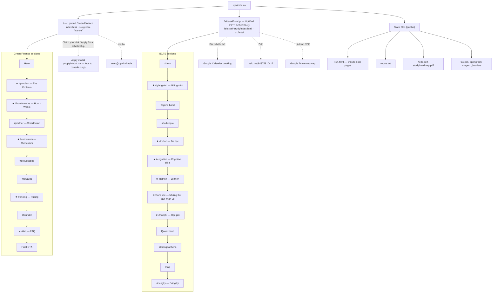

# upwind.asia site map

Two landing pages plus a few static files. Each page is one long scroll; the boxes under a page
are its sections in scroll order (`#anchor` = the section's link target). Sections marked ★ are in
that page's top nav.

There is no `sitemap.xml` yet.
