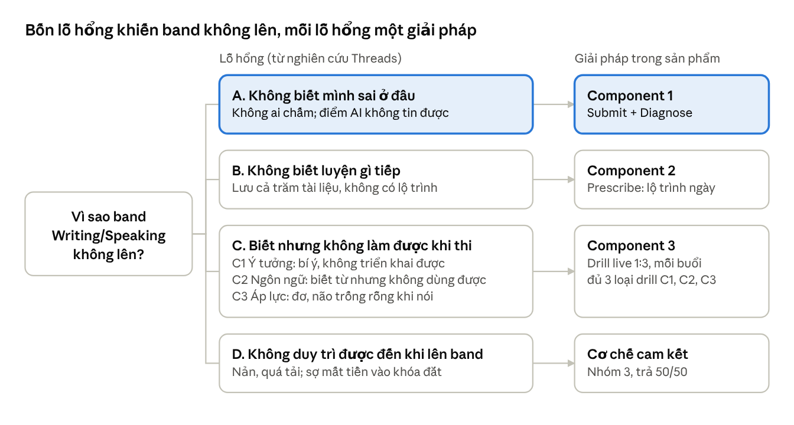
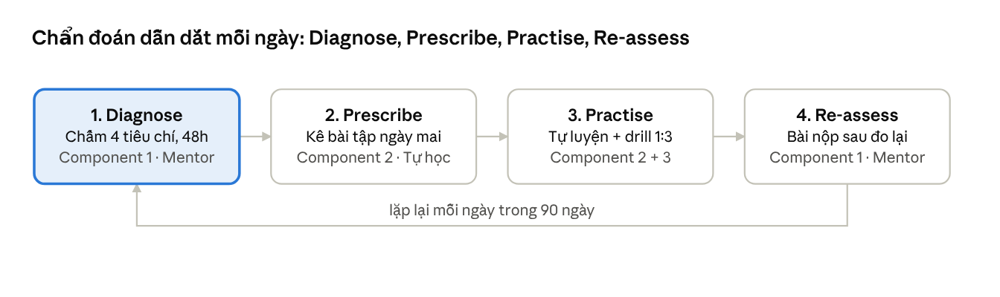

# UpWind Intensive Mastery W&S — Landing Page Brief

Oct 23, 2026 · @Nam Khanh

A brief for Claude Design: one landing page that sells a 3-month, small-group (1 teacher : 3 students) Writing & Speaking program at 5 million VND, built on the pain points found in the [social listening doc](https://claude.ai/artifact/MgjxxT4ke7bgteL9Y96YxQ).

## Goal and audience

The page must get a stuck self-learner to book a free placement test, convinced that 5 million VND buys real teacher feedback.

- **Who:** learners at Writing/Speaking 5.0–6.5 who want +0.5 to +1.0 band. They already know the basics but have stalled. Many self-study, have quit or avoided a full course, or find 30–60 million VND courses too expensive.
- **Primary action:** "Đăng ký test đầu vào miễn phí" *(register for a free placement test)*. Secondary: chat with an advisor on Zalo.
- **Core insight (from Threads):** the pain is not missing materials. It is "cảm giác bất lực khi tự học: không ai sửa bài" *(the helplessness of self-study: nobody corrects my work)*, plus freezing in Speaking.
- **Positioning in one line:** guided self-study. Students keep the price and flexibility of self-study, but a Writing/Speaking 8.0 teacher plans and marks every task.

Message hierarchy (what the visitor must believe, in order):

1. "This is my problem": stuck, nobody tells me what's wrong, I freeze.
2. "This fixes the cause": every task marked within 48 hours, plus live drills against freezing.
3. "It's affordable and low-risk": 5 million VND, small group of 3, pay 50% now and 50% only after a 1-month trial.
4. "It works": teacher credentials, before/after bands, sample marked essay.

## Problem structure (MECE)

Every feature on the page must close one specific reason why the band does not rise; anything that closes none gets cut. The four gaps follow the learning cycle in order: knowing what's wrong, knowing what to do next, doing it under exam conditions, and keeping going long enough. Each step can fail independently, and together they cover why practice does not turn into a higher band.

Gap C is where "anti-freeze" lives. Freezing is not one problem but three separate causes (C1 no idea, C2 no words, C3 pressure), so each needs its own drill.

## Key framework: Summit model + Diagnostic–Prescriptive process

Summit Learning defines how the program runs; Diagnostic–Prescriptive Teaching defines what happens every day inside it. Each of Summit's three pillars ([Summit blog](https://blog.summitlearning.org/?p=2754)) becomes one component, and the diagnostic loop connects all three.

| Summit pillar | In Summit Learning | In UpWind Intensive Mastery | Component |
| --- | --- | --- | --- |
| Mentoring | A mentor helps each student set goals and reviews their progress | A teacher with Writing/Speaking 8.0 marks every task within 48h and owns the learner's error log | **1 · Mentoring** (diagnosis happens here) |
| Self-directed learning | Students work through content online at their own pace | A personalised 90-day plan: one prescribed task a day, plus materials and software | **2 · Self-directed learning** (prescription happens here) |
| Project-based learning | Projects apply skills to real tasks | 6 live 1:3 sessions apply skills under exam conditions through drilling | **3 · Applied practice** (live drill) |

The lesson from Summit's criticism (too much screen time, too little direct guidance; [Chalkbeat](https://www.chalkbeat.org/2019/5/23/21121032/summit-learning-the-zuckerberg-backed-platform-says-10-of-schools-quit-using-it-each-year-the-real-f)) is the reason the 48-hour human marking promise is non-negotiable.

The process runs as a daily loop: diagnose, prescribe, practise, re-assess.

Diagnosis is the engine: every component either produces a diagnosis (Component 1) or acts on one (Components 2 and 3). The loop should be the backbone of the page's "How it works" section.

## The offer

Intensive Mastery Writing & Speaking costs 5 million VND for 3 months. A typical full course costs 30–60 million VND, so this is roughly 1/6 to 1/12 of that price.

Each component closes exactly one gap from the problem tree and applies to both skills.

| Gap | Component | Writing | Speaking | Student evidence |
| --- | --- | --- | --- | --- |
| A. Doesn't know what's wrong | **1 · Mentoring** (diagnosis) | Hand in an essay, marked within 48h on the 4 criteria (TR, CC, LR, GRA), errors added to a personal error log | Hand in a recording, reviewed within 48h on the 4 criteria (FC, LR, GRA, P), errors added to the same log | "không ai sửa bài writing" *(nobody corrects my writing)*; "ChatGPT 6.0, Lexibot 4.0" |
| B. Doesn't know what to practise next | **2 · Self-directed learning (prescription)** | The next day's task targets the top error in the log, within a 90-day syllabus | Same, from the speaking errors | "lưu cả trăm tài liệu" *(saved hundreds of files)*, no plan |
| C. Can't perform under exam conditions | **3 · Applied practice (live 1:3 drill)** | 3 live sessions, each running all three drill types C1–C3 (table below) | 3 live sessions, same structure | "não trống rỗng" *(mind goes blank)*; "bí ý" *(no ideas)* |
| D. Can't keep going until the band rises | **Commitment mechanism** | Group of 3 on the same schedule; 50% upfront, 50% after month 1, no further payment if the learner stops | Same | "nản" *(discouraged)*; 30–60 million VND courses felt too risky |

Anti-freeze, broken into its three causes. Each cause gets one drill in class and one at home.

| Cause of freezing | Drill in the live session | Drill at home (software) |
| --- | --- | --- |
| C1 · No idea | Angle drill: the teacher gives a Task 2 or Part 3 question and the learner has 10 seconds to give 3 angles using PESTEL or systems thinking | One random question a day, answered with an outline in 2 minutes |
| C2 · No words | Rewrite & reuse: the teacher rewrites the learner's own translated-sounding sentences, and the learner must reuse them in the next answer | Flashcards built from the learner's own error log, not generic word lists |
| C3 · Pressure | Mock examiner: timed answers with follow-up questions and interruptions | A timed recording on a random topic, one take only, with no re-recording |

All in-class and software drill details above are proposals; confirm what the software can actually do.

Three price comparisons the page should show side by side:

|  | Full course at a centre | Self-study alone | UpWind Intensive Mastery |
| --- | --- | --- | --- |
| Price | 30–60 million VND | Free | 5 million VND |
| Who marks your work | Teacher, but in a big class | Nobody, or an AI score you don't trust | 8.0 teacher, within 48 hours, unlimited |
| Speaking practice | Limited turns in class | Alone | Small group of 3 + software drills |
| Daily plan | Fixed for the whole class | Hundreds of saved files, no plan | One personalised task per day |

## Page structure and copy

The page has nine sections in this order. Page copy is in Vietnamese; the notes in italics are for the designer.

1. **Hero:** state the outcome and the price in one screen.
   - Headline: "Tự học Writing & Speaking — nhưng có giảng viên 8.0 chấm từng bài, mỗi ngày."
   - Sub-headline: "3 tháng, nhóm 3 học viên, chấm chữa không giới hạn trong 48 giờ. Chỉ 5 triệu — thay vì 30–60 triệu cho một khóa full."
   - CTA: "Test đầu vào miễn phí" + secondary "Chat Zalo tư vấn".
   - *Visual: a real marked essay with teacher comments in the margin, or a phone showing a "Đã chấm — 46 giờ" (marked in 46 hours) notification.*
2. **Pain mirror:** make visitors recognise themselves, using real student phrases from Threads.
   - Title: "Bạn có đang ở đây?"
   - Three cards: "Viết xong không biết mình sai ở đâu" · "Vào Speaking là não trống rỗng" · "Mãi kẹt ở 5.5–6.5, AI chấm mỗi nơi một điểm".
3. **The idea (guided self-study):** show the new category between a full course and studying alone.
   - Title: "Không phải khóa full. Không phải tự bơi. Là tự học có người cầm lái."
   - *Visual: the three-column comparison table from The offer.*
4. **How it works:** the Diagnose → Prescribe → Practise → Re-assess loop from the Key framework diagram. Title: "Chẩn đoán → Kê bài → Luyện → Đo lại — mỗi ngày, trong 90 ngày."
   - Test đầu vào → Nhận lộ trình 90 ngày cá nhân hóa → Làm bài mỗi ngày, nhận chữa trong 48h → 6 buổi live drilling (3 Writing + 3 Speaking).
5. **What's included:** three cards, Component 1, 2 and 3, from The offer. Label the cards with the Summit pillars (Mentoring, Self-directed learning, Applied practice), and give Component 1 the strongest visual weight.
6. **Anti-freeze speaking:** a dedicated section for the second-biggest pain.
   - Title: "Chống đơ khi nói — luyện phản xạ với giảng viên và phần mềm"
   - Structure it as the 3 causes of freezing (C1 no idea, C2 no words, C3 pressure), with one card per cause showing its drill.
7. **Proof:** teacher profiles with real score reports, before/after band of past students, a sample marked essay, and 2–3 screenshot-style testimonials.
8. **Price and guarantee:** one price card.
   - "5.000.000đ / 3 tháng". Show the anchor "Khóa full: 30–60 triệu" crossed out. Add "Chỉ 3 học viên / lớp — còn X chỗ" (only 3 students per class, X seats left) and the payment badge "Trả trước 50% — 50% còn lại sau 1 tháng học thử" (pay 50% now, the rest after a 1-month trial).
9. **FAQ + final CTA:** answer the objections, then repeat the CTA.
   - "6 buổi có đủ không?" (are 6 sessions enough?) · "Không giới hạn là bao nhiêu bài?" (what does unlimited mean?) · "Nếu học 1 tháng thấy không hợp thì sao?" (what if it isn't right for me after a month? Answer: dừng lại, không trả 50% còn lại) · "Lịch học thế nào?" (what's the schedule?) · "Ai chấm bài — giảng viên hay AI?" (who marks my work, a teacher or AI?)

Copy rules: name the pain in the student's own words, use numbers instead of adjectives (48 giờ, 1:3, 90 ngày, 5 triệu), and make no band-increase promise the refund terms don't back.

## Design direction

The page should feel calm, honest and personal: a coach's notebook, not a loud centre advert.

- **Mobile-first:** most traffic will come from Threads and Facebook on phones. Design at 390px first, with a sticky bottom CTA bar on mobile.
- **Tone:** warm and direct, peer-to-peer Vietnamese ("bạn"). No hype words like "thần tốc" or "cam kết 100%", which students on Threads distrust as seeding.
- **Visual motif:** red-pen marking on a real essay, and a 48-hour clock. Use real artefacts (marked essays, score reports, chat screenshots) instead of stock photos.
- **Brand:** use UpWind's existing logo, colours and fonts. A wind or upward-arrow accent fits the name.
- **Components:** hero with marked-essay visual, three pain cards, a three-column comparison table, a 4-step timeline, an icon grid, a framework diagram, teacher profile cards, one price card with crossed-out anchor, FAQ accordion, sticky CTA.
- **Trust signals near every CTA:** "Giảng viên 8.0", "Chấm trong 48h", "Chỉ 3 học viên/lớp".

## Open questions

Confirm these before sending the brief to design; the page cannot make promises it can't back.

- [ ] **Payment terms:** 50% upfront, 50% after a 1-month trial (confirmed). Confirmed: a student who stops after the trial month does not pay the remaining 50%.
- [ ] **Price claim:** 5 million VND is 1/6 of 30 million VND but 1/12 of 60 million VND. Should the page say "chỉ bằng 1/6" or "tiết kiệm đến 90%"?
- [ ] **Sessions:** is it 3 sessions per skill (6 in total)? How long is each, and on what days and times?
- [ ] **"Unlimited" marking:** is there a fair-use cap, for example 1 Writing task + 1 Speaking recording per day?
- [ ] **Software:** what is the name of the anti-freeze practice tool, and can we show a screenshot?
- [ ] **Entry level:** what minimum band is required? Is the placement test free, and is it online?
- [ ] **Proof:** do we have teacher score reports, past student results, and permission to show marked essays and testimonials?
- [ ] **CTA channel:** form, Zalo, or Messenger? Who follows up, and how fast?
- [ ] **Scarcity:** how many 1:3 classes open per intake, and when does the next one start?
