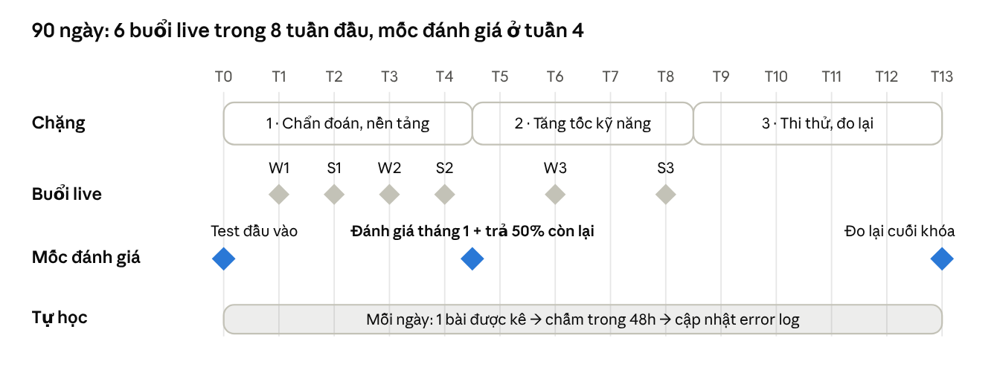

# Thiết kế khóa Intensive Mastery Writing & Speaking

Khóa 90 ngày đưa học viên Writing/Speaking 5.5–6.5 lên thêm 0.5–1.0 band, dựa trên persona trong tab CLO và lỗi thường gặp trong tab Roadmap v2 của sheet UpWind Student Roadmap. Khóa dạy theo kỹ năng, không theo khung cố định: mỗi lỗi được nối với kỹ năng còn thiếu, rồi với đúng một buổi học hoặc một loại bài tập.

## Tổng quan khóa

| Hạng mục | Thiết kế |
| --- | --- |
| Đầu vào | Writing/Speaking 5.5–6.5. Đã biết dạng bài, đang chững band. Đánh giá bằng test đầu vào miễn phí (1 bài Task 2 + 1 Task 1 + Speaking đủ 3 part, ghi âm). |
| Đầu ra | +0.5 đến +1.0 band ở từng kỹ năng; mục tiêu thường gặp là 6.0 → 7.0. |
| Thời lượng | 90 ngày (13 tuần). |
| Buổi live (Component 3) | 6 buổi × 90 phút, nhóm 1 GV : 3 HS. Writing W1–W3, Speaking S1–S3, xen kẽ trong 8 tuần đầu. |
| Chấm chữa (Component 1) | Mọi bài nộp được chấm trong 48 giờ theo 4 tiêu chí, gắn mã lỗi vào error log. |
| Tự học (Component 2) | Mỗi ngày một bài được kê từ lỗi nặng nhất trong error log, khoảng 20–30 phút. |
| Mốc tháng 1 | Cuối tuần 4: bài đo lại + báo cáo tiến bộ. Đây là lúc học viên quyết định thanh toán 50% còn lại, nên tháng 1 phải cho thấy tiến bộ đo được. |

## Learning outcome: band 7.0 khác ở chỗ nào

Mỗi tiêu chí có một objective đo được, viết từ dòng "band 7.0 khác ở chỗ" của band descriptors. Đây cũng là thang để GV chấm bài đo lại cuối tháng 1 và tháng 3.

| Kỹ năng | Tiêu chí | Band 6.0 (persona hiện tại) | Band 7.0 khác ở chỗ | Objective đo được cuối khóa |
| --- | --- | --- | --- | --- |
| Writing | Task Response | Có lập trường nhưng chứng minh chưa rõ; ý chính lặp hoặc phát triển thiếu | Lập trường rõ từ đầu đến cuối; ý chính được mở rộng và chứng minh | Mỗi ý chính trả lời được ít nhất 2 trong 4 câu hỏi: vì sao đúng, vì sao liên quan, vì sao quan trọng, so what |
| Writing | Coherence & Cohesion | Ý không tiến triển; dùng từ nối máy móc | Có tiến triển rõ xuyên suốt; mỗi đoạn một chủ đề trung tâm | Viết được 1 câu tóm tắt cho mỗi đoạn trước khi viết; GV không tìm thấy đoạn nào có 2 ý chính |
| Writing | Lexical Resource | Đủ dùng nhưng hẹp; sai word form, dịch từ tiếng Việt | Dùng từ linh hoạt, có collocation ít phổ biến, ý thức về văn phong | Số lỗi LR (mã LR1–LR3) giảm một nửa so với bài đầu vào |
| Writing | Grammar | Trộn câu đơn và câu phức, còn lỗi | Nhiều câu phức, phần lớn câu không lỗi | Ít nhất 50% số câu không lỗi trong bài đo lại |
| Speaking | Fluency & Coherence | Muốn nói dài nhưng mất mạch vì ngập ngừng, lặp, tự sửa | Nói dài không tốn sức; ngập ngừng chỉ vì tìm từ, không vì hết ý | Part 3: trả lời câu lạ trong 10 giây với 3 góc nhìn; Part 2: nói đủ 2 phút không dừng quá 3 giây |
| Speaking | Lexical Resource | Đủ nói chủ đề quen; đơ khi quên từ | Có từ ít phổ biến và idiomatic; paraphrase hiệu quả | Khi quên từ, diễn đạt vòng (circumlocution) được thay vì dừng |
| Speaking | Grammar | Trộn câu ngắn và phức, kém linh hoạt | Dùng linh hoạt câu phức, nhiều câu không lỗi | Không mất kiểm soát thì khi nói nhanh (mã GR1 giảm dần theo từng bản ghi) |
| Speaking | Pronunciation | Hiểu được nhưng kiểm soát chưa đều | Kiểm soát nhịp và ngữ điệu ổn định hơn | Giữ được nhịp nói khi bị hỏi dồn (mock examiner) |

Cột "Band 7.0 khác ở chỗ" diễn giải từ band descriptors bản công khai qua các bản sao ([Writing Task 2](https://www.dei.unict.it/sites/default/files/documenti_sito/Writing-Band-descriptors-Task-2.pdf), [Speaking](https://www.ieltsbuddy.com/support-files/ielts-speaking-public-band-descriptors.pdf)); chưa đối chiếu với file gốc trên ielts.org. Cột band 6.0 lấy từ tab CLO. Ngưỡng % trong cột objective là đề xuất, cần UpWind chốt.

## Bản đồ kỹ năng: lỗi → kỹ năng thiếu → nơi dạy

Mỗi lỗi trong Roadmap v2 được nối với một lỗ hổng trong cây vấn đề (tab chính) và một nơi dạy duy nhất. Lỗi nào cũng có chỗ dạy, và không buổi nào dạy lặp kỹ năng của buổi khác.

| # | Lỗi thường gặp (Roadmap v2) | Lỗ hổng | Kỹ năng còn thiếu | Dạy ở đâu |
| --- | --- | --- | --- | --- |
| 1 | Bí ý khi brainstorm Task 2 | C1 Ý tưởng | Brainstorm theo khía cạnh: PESTLE, stakeholder, mức độ tác động | W1 |
| 2 | Lập luận yếu: claim không có lý do, lập luận vòng, lấy ví dụ thay lý do, khái quát quá mức | C1 Ý tưởng | Chuỗi lập luận bằng 4 câu hỏi: vì sao đúng, liên quan, quan trọng, so what | W1 |
| 3 | Không trả lời đủ yêu cầu đề | A (chẩn đoán) + C1 | Logic theo dạng đề: opinion, discussion, problem–cause–solution, adv/disadv, two-part | W2 |
| 4 | Đoạn yếu: thiếu topic sentence, nhiều ý nhưng mỏng, từ nối máy móc | C1 + C2 | PEEL, một ý trung tâm mỗi đoạn, liên kết bằng từ quy chiếu thay vì từ nối | W2 |
| 5 | Task 1: liệt kê mọi số liệu; overview thiếu xu hướng chính; sắp xếp rời rạc | C1 Ý tưởng | Chọn key features, nhóm số liệu, viết overview | W3 |
| 6 | Từ vựng/ngữ pháp quá đơn giản hoặc gượng quá mức; quản lý thời gian kém | C2 + C3 | Dùng từ theo ngữ cảnh, paraphrase; phân bổ 5–30–5 phút | W3 + bài tập rewrite & reuse hằng ngày |
| 7 | Speaking: trả lời ngập ngừng, ít nội dung | C1 + C3 | Phát triển ý bằng AREA (Answer–Reason–Example–Alternative) | S1 |
| 8 | Part 3: trả lời từ góc cá nhân, claim không lý do, khẳng định tuyệt đối | C1 Ý tưởng | Systems thinking từ góc xã hội; hedging | S1 |
| 9 | Part 3: thiếu từ nối giữa các ý, thiếu ví dụ | C1 | Liên kết ý trong lời nói; ví dụ đào sâu | S1 (ôn trong drill) |
| 10 | Part 2: hết ý trước 2 phút; kể liệt kê, không có mạch truyện | C1 + C3 | Story arc và 5W1H; chiến lược quá khứ–hiện tại–tương lai; bộ core stories dùng cho nhiều đề | S2 |
| 11 | Part 2: mở bài quá dài, kết vội; sai thì khi nói nhanh | C3 Áp lực | Kiểm soát thời gian theo mốc 30–90–120 giây | S2 |
| 12 | Từ vựng cơ bản lặp lại; đơ khi quên từ; dịch từng chữ từ tiếng Việt; mọi cue card cùng một kiểu nói | C2 Ngôn ngữ | Lexical chunks, collocation theo topic, circumlocution, paraphrase | S3 |
| 13 | Không học từ lỗi cũ (không có error log) | A + B | Error analysis: đọc mã lỗi, tự sửa trước khi nộp | Onboarding (buổi 0, tự học) + Component 1 |

Lỗi 1–12 lấy từ tab Roadmap v2 (tuần 5–15). Lỗ hổng D (không duy trì được) không có trong Roadmap v2; nó đến từ nghiên cứu Threads và được xử lý bằng cơ chế nhóm 3 và thanh toán 50/50, không bằng buổi học.

## Lộ trình 90 ngày

Cả 6 buổi live nằm trong 8 tuần đầu. 4 buổi rơi vào tháng 1, nên khi đến mốc đánh giá tháng 1, học viên đã học đủ kỹ năng ý tưởng và mạch lạc cho cả Writing lẫn Speaking. 5 tuần cuối không có buổi live, chỉ có bài bấm giờ và chấm chữa, để HS tự vận hành vòng chẩn đoán trước khi thi.

Bài đo lại ở tuần 4 và tuần 13 dùng cùng định dạng với test đầu vào, nên so sánh trực tiếp được theo từng tiêu chí và từng mã lỗi.

## 6 buổi live (Component 3)

Mỗi buổi dạy 2–3 kỹ năng mới; kỹ năng của buổi trước chỉ được nhắc lại và dùng như công cụ. Buổi Speaking đứng sau buổi Writing cùng loại kỹ năng, nên phần chung (ví dụ PESTLE) chỉ ôn và chuyển sang dạng nói.

| Buổi | Tuần | Trọng tâm | Kỹ năng mới | Objective (band 7.0 khác ở chỗ) | Drill chống đơ |
| --- | --- | --- | --- | --- | --- |
| W1 | 1 | Task 2: ý tưởng và lập luận | (1) Brainstorm theo PESTLE, stakeholder, mức độ tác động (2) Chuỗi 4 câu hỏi phát triển ý | Đưa 3 góc nhìn trong 10 giây; phát triển 1 góc thành lập luận 3 tầng | C1 angle drill |
| S1 | 2 | Part 1 + Part 3: nói dài có nội dung | (1) AREA (2) Góc xã hội và hedging. Ôn: PESTLE từ W1 dùng cho nói | Part 3: trả lời câu lạ trong 10 giây với 3 góc, có ít nhất 1 câu hedge | C1 angle drill + C3 mock examiner |
| W2 | 3 | Task 2: trả lời đủ đề, đoạn mạch lạc | (1) Logic theo dạng đề (2) PEEL, một ý trung tâm (3) Liên kết bằng từ quy chiếu | Viết câu tóm tắt mỗi đoạn trước khi viết; không đoạn nào có 2 ý chính | C2 rewrite & reuse trên đoạn của chính HS |
| S2 | 4 | Part 2: kể đủ 2 phút | (1) Story arc + 5W1H (2) Core stories dùng cho nhiều đề (3) Mốc thời gian 30–90–120 giây | Nói đủ 2 phút, không dừng quá 3 giây; 1 core story cho 3 cue card khác nhau | C3 one-take có bấm giờ + C1 |
| W3 | 6 | Task 1 + ngôn ngữ chính xác | (1) Chọn key features, nhóm số liệu (2) Overview (3) Paraphrase từ lỗi LR của chính HS | Overview nêu đủ xu hướng chính; viết Task 1 trong 20 phút | C2 rewrite & reuse |
| S3 | 8 | Từ vựng dưới áp lực | (1) Lexical chunks, collocation theo topic (2) Circumlocution (3) Paraphrase giữa các cue card | Quên từ thì diễn đạt vòng thay vì dừng; hoàn thành mock đủ 3 part | C2 + C3 mock examiner |

Khung chung cho mỗi buổi 90 phút (sẽ chi tiết hóa theo format "Overall" của Lesson Map sau khi bạn duyệt):

1. Trả chẩn đoán tuần (10'): GV chiếu 3 mã lỗi nặng nhất của nhóm từ error log.
2. Kỹ năng trọng tâm (30'): mỗi kỹ năng theo thứ tự là gì → vì sao cần → các bước → ví dụ từ bài của chính HS, có 1 câu làm mẫu đi hết quy trình.
3. Drill (40'): xoay vòng 3 HS, mỗi lượt GV chấm ngay theo mã lỗi.
4. Đo lại và kê bài (10'): mỗi HS làm 1 câu mới để đo; GV chốt bài tập tuần sau trong lộ trình 90 ngày.

## Mã chẩn đoán (error log)

Component 1 vận hành bằng một bộ mã lỗi chung cho GV và HS, giống bộ mã bẫy T0–T7 bên Reading/Listening. GV gắn mã khi chấm; Component 2 đọc mã xuất hiện nhiều nhất để kê bài hôm sau. Ví dụ có dấu 🔸 là câu giả định, sẽ thay bằng câu thật từ bài test đầu vào.

| Mã | Lỗi là gì | Vì sao HS mắc | Ví dụ | Cách né (HS tự hỏi) |
| --- | --- | --- | --- | --- |
| TR1 | Không trả lời đủ mọi phần của đề | Đọc đề lướt, viết theo template có sẵn | 🔸 Đề two-part hỏi "why" và "is it positive", bài chỉ trả lời "why" | Đề có mấy câu hỏi? Mỗi câu nằm ở đoạn nào? |
| TR2 | Đưa claim nhưng không có lý do, hoặc lấy ví dụ thay lý do | Quen lập luận 2 tầng (ý + lý do đơn giản) | 🔸 "Online learning is effective. For example, my cousin studies online." | Câu này trả lời được "vì sao đúng" chưa? |
| TR3 | Khái quát quá mức, khẳng định tuyệt đối | Muốn lập luận nghe mạnh | 🔸 "Everyone uses social media every day." | Có cần hedge không: most, tend to, in many cases? |
| CC1 | Một đoạn có 2 ý chính, hoặc thiếu topic sentence | Nhồi ý để bài "đủ dài" | 🔸 Đoạn nói về chi phí rồi chuyển sang sức khỏe | Tóm tắt đoạn này bằng 1 câu được không? |
| CC2 | Từ nối máy móc hoặc dùng sai | Học thuộc danh sách linking words | 🔸 Câu nào cũng mở đầu bằng Moreover, Furthermore | Bỏ từ nối đi thì ý còn nối được bằng this/such/these không? |
| LR1 | Collocation dịch từng chữ từ tiếng Việt | Nghĩ bằng tiếng Việt rồi dịch | 🔸 "learn knowledge", "make a crime" | Cụm này người bản xứ có nói không? Tra collocation |
| LR2 | Sai word form hoặc chính tả | Biết nghĩa nhưng không biết word family | 🔸 "It is benefit for students" | Chỗ này cần danh, động hay tính từ? |
| LR3 | Từ "cao siêu" sai ngữ cảnh | Tin rằng từ khó = điểm cao | 🔸 "ameliorate" dùng cho "make better" trong văn nói | Từ này đúng sắc thái và văn phong chưa? |
| GR1 | Sai thì hoặc hòa hợp chủ–vị, nhất là khi nói nhanh | Tập trung vào ý nên bỏ quên ngữ pháp | 🔸 Part 2 kể chuyện quá khứ bằng thì hiện tại | Câu chuyện xảy ra khi nào? |
| GR2 | Câu phức vỡ cấu trúc | Cố dùng câu phức để được điểm | 🔸 Mệnh đề quan hệ thiếu động từ chính | Câu này có động từ chính chưa? |
| FC1 | Đơ, dừng dài vì hết ý (không phải vì tìm từ) | Không có khung tìm ý nhanh | 🔸 Part 3 "Why do cities grow?" → im lặng 6 giây | Góc nào trong PESTLE dùng được ngay? |
| FC2 | Trả lời quá ngắn, không phát triển | Sợ sai nên nói ít | 🔸 "Yes, I like it because it is fun." | Đã đủ A–R–E–A chưa? |
| FC3 | Part 2 hết giờ hoặc hết ý trước 2 phút | Không chia thời gian theo mốc | 🔸 1 phút đầu chỉ tả bối cảnh | Đã qua mốc 90 giây chưa, đang ở đoạn nào của story arc? |
| FC4 | Đơ khi quên một từ | Chưa từng luyện diễn đạt vòng | 🔸 Quên "florist" rồi dừng hẳn | Mô tả được nó bằng 1 câu không: "the person who sells flowers"? |

Mã TR/CC/LR/GR dùng cho Writing; FC và các mã LR/GR dùng chung cho Speaking. Pronunciation chưa có mã riêng vì persona đã ở mức 7 (tab CLO); có thể thêm nếu bài test đầu vào cho thấy cần.

## Nhịp bài tập hằng tuần (Component 2)

Mỗi ngày một bài ngắn, mỗi bài đóng một lỗ hổng, cả tuần xoay đủ 4 lỗ hổng. Nội dung cụ thể của từng bài do mã lỗi nặng nhất trong error log quyết định, nên hai HS cùng nhóm có thể nhận bài khác nhau.

| Ngày | Bài | Thời lượng | Đóng lỗ hổng | GV chấm trong 48h? |
| --- | --- | --- | --- | --- |
| Thứ 2 | Task 2: dàn ý + 1 đoạn thân bài | 25' | C1 Ý tưởng | Có |
| Thứ 3 | Speaking Part 1 + 3: ghi âm 3 câu | 10' | C1 + C3 | Có |
| Thứ 4 | Rewrite & reuse: viết lại 5 câu bị gắn mã LR/GR, ôn flashcard từ error log | 20' | C2 Ngôn ngữ | GV xem nhanh, không chấm đầy đủ |
| Thứ 5 | Part 2: ghi âm một lần, chủ đề ngẫu nhiên, không ghi lại | 10' | C3 Áp lực | Có |
| Thứ 6 | Bài bấm giờ: Task 2 đủ bài (40'), từ tuần 6 xen kẽ Task 1 (20') | 20–40' | A (đo lại) | Có, chấm đủ 4 tiêu chí |
| Thứ 7 | Đọc lại error log, tự chọn mã lỗi muốn sửa tuần sau | 15' | B + D | Không, GV xác nhận mã đã chọn |
| Chủ nhật | Nghỉ hoặc làm bù | — | D | — |

Tải chấm ước tính (số đề xuất, cần đo thật): khoảng 4 bài chấm đầy đủ + 2 bài xem nhanh mỗi HS mỗi tuần, tức khoảng 35 phút chấm mỗi HS và gần 2 giờ cho một nhóm 3. "Chấm không giới hạn" nghĩa là bài nộp thêm ngoài nhịp này vẫn được chấm. Nên chốt mức fair use (ví dụ tối đa 1 bài thêm mỗi ngày) để giữ được cam kết 48 giờ.

## Bước tiếp theo và nguồn

Bản này là khung khóa để duyệt. Sau khi bạn duyệt, mình sẽ soạn chi tiết từng buổi theo skill, bắt đầu từ W1.

- [ ] Duyệt bản đồ kỹ năng và thứ tự 6 buổi
- [ ] Duyệt bộ mã lỗi (thêm, bớt, đổi tên)
- [ ] Chốt ngưỡng objective và mức fair use
- [ ] Soạn W1 chi tiết: kiến thức, chữa bài mẫu, Activity theo format "Overall", Homework
- [ ] Chọn đề thật cho từng buổi (ưu tiên Cambridge 17–20)

Nguồn:

- [UpWind Student Roadmap](https://docs.google.com/spreadsheets/d/1M5kbxy__vfY7etwj2Z20J0k9KK0JT_dbnPGUiKAlMZE): các tab CLO, Roadmap v2, Lesson Map
- [Writing Task 2 band descriptors, bản công khai (bản sao)](https://www.dei.unict.it/sites/default/files/documenti_sito/Writing-Band-descriptors-Task-2.pdf)
- [Speaking band descriptors, bản công khai (bản sao)](https://www.ieltsbuddy.com/support-files/ielts-speaking-public-band-descriptors.pdf)
- Nghiên cứu Threads và cây vấn đề: tab chính của doc này
